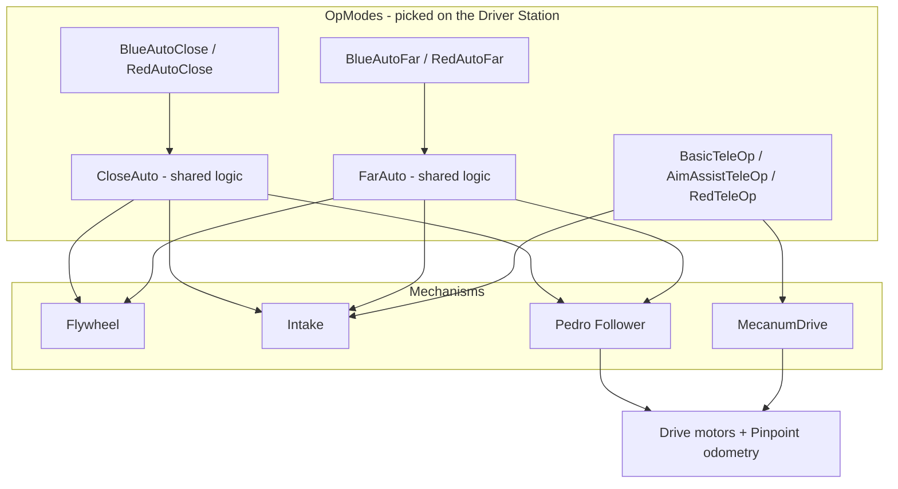
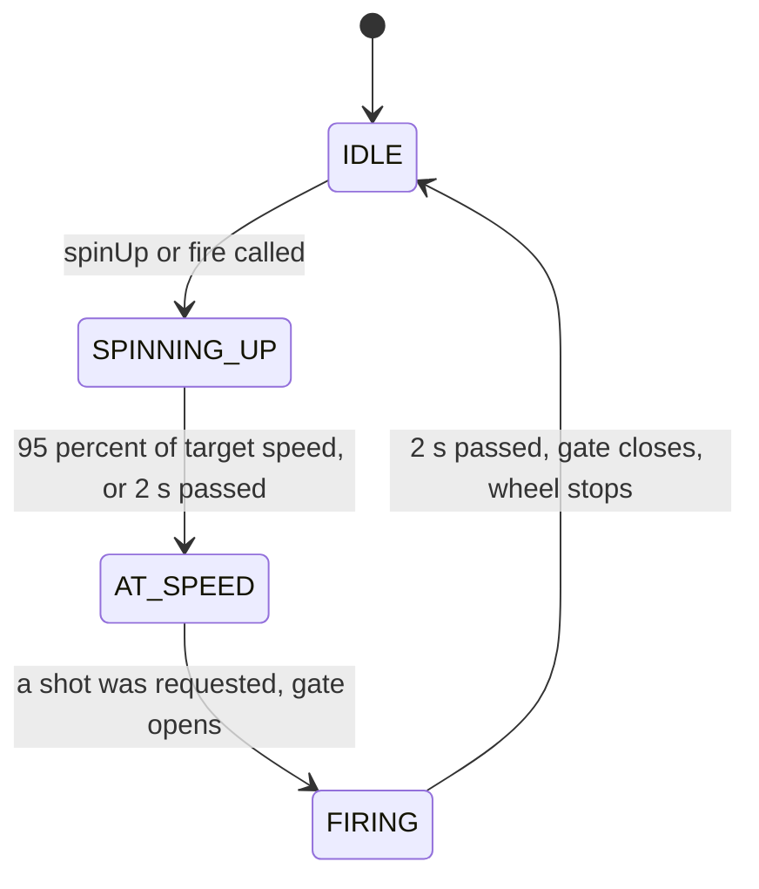

# TeamCode Guide

A walkthrough of our robot code for the DECODE (2025–2026) season, for anyone on the team learning it, whether you're brand new to FTC programming or just new to this codebase.

All of our code lives in [`TeamCode/src/main/java/org/firstinspires/ftc/teamcode/`](TeamCode/src/main/java/org/firstinspires/ftc/teamcode/). Everything else in this repository is the FTC SDK or the Pedro Pathing library, and we don't edit it.

## How to use this guide

Read it in order the first time. Each section builds on the last. Keep the code open beside it and find each file as it comes up.

1. [Setup: build and run the code](#1-setup-build-and-run-the-code)
2. [Glossary](#2-glossary)
3. [Java you'll see in this code](#3-java-youll-see-in-this-code)
4. [The big picture](#4-the-big-picture)
5. [How an OpMode runs](#5-how-an-opmode-runs)
6. [Mechanisms](#6-mechanisms)
7. [Pedro Pathing](#7-pedro-pathing)
8. [Autonomous routines](#8-autonomous-routines)
9. [TeleOp](#9-teleop)
10. [Limelight vision](#10-limelight-vision)
11. [Tests and tuners](#11-tests-and-tuners)
12. [How do I…? (common changes)](#12-how-do-i-common-changes)
13. [Debugging](#13-debugging)
14. [Why the code is built this way](#14-why-the-code-is-built-this-way)
15. [Bugs we found and what they teach](#15-bugs-we-found-and-what-they-teach)
16. [Known limitations](#16-known-limitations)
17. [Check your understanding](#17-check-your-understanding)

---

## 1. Setup: build and run the code

**You need:** Android Studio (Ladybug 2024.2 or newer), this repository cloned, and the robot's Control Hub.

1. Open the repository's top folder in Android Studio and let Gradle sync finish (bottom status bar).
2. Turn on the robot and connect your computer to the Control Hub's Wi-Fi (or plug in with USB).
3. Pick **TeamCode** in the run configuration dropdown at the top and press the green **Run** ▶ button. This builds the app and installs it on the Control Hub.
4. On the Driver Station, choose an OpMode from the Autonomous (left) or TeleOp (right) list, press **INIT**, then **▶ (start)**.

### Robot configuration names

The code finds each device by the name saved in the robot's configuration on the Driver Station. **These must match exactly** (including capital letters), or the OpMode crashes at INIT.

| Name in config | Device | Used by |
|---|---|---|
| `lf`, `rf`, `lr`, `rr` | Drive motors (left-front, right-front, left-rear, right-rear) | `MecanumDrive`, Pedro |
| `intake` | Intake roller motor | `Intake` |
| `transfer` | Transfer motor (carries artifacts to the shooter) | `Intake` |
| `shooter` | Flywheel motor | `Flywheel`, teleops |
| `hoodServo` | Hood servo (launch angle) | `Flywheel`, teleops |
| `gateServo` | Gate servo (holds artifacts back) | `Flywheel`, teleops |
| `pinpoint` | goBILDA Pinpoint odometry computer | Pedro |
| `limelight` | Limelight 3A camera | teleops, tests |
| `imu` | Control Hub's built-in IMU | teleops, tests |

---

## 2. Glossary

| Term | Meaning |
|---|---|
| **OpMode** | One program the driver can pick on the Driver Station, like "Blue Auto Close". |
| **Autonomous / TeleOp** | The first 30 s of a match where the robot drives itself, and the driver-controlled period after it. |
| **Hardware map** | The SDK's lookup table from configuration names (like `"shooter"`) to device objects. |
| **Encoder** | A sensor on a motor that counts how far it has turned. |
| **Tick** | One count from an encoder. Velocities here are in **ticks per second**. |
| **Servo position** | A number from 0 to 1 that tells a servo what angle to hold. |
| **Telemetry** | Text the robot sends to the Driver Station screen. It's our main debugging tool. |
| **Pose** | A position and direction on the field: `(x, y, heading)`. Pedro uses inches and radians. |
| **Odometry** | Tracking the robot's pose by measuring how far its wheels have rolled. |
| **PIDF** | A feedback controller. It adjusts output based on error (P), accumulated error (I), change in error (D), plus a feedforward guess (F). See [section 6](#flywheel-pidf-in-plain-words). |
| **State machine** | Code that is always in exactly one named *state* and moves to the next when a condition becomes true. |
| **Artifact** | The DECODE game piece the robot shoots. |
| **Spike mark** | A spot on the field where artifacts start a match. |
| **AprilTag** | A printed black-and-white marker that cameras can identify and measure. |
| **tx / ty / ta** | Limelight results: horizontal angle, vertical angle, and how much of the image the tag fills. |

---

## 3. Java you'll see in this code

You don't need to know all of Java. These are the parts this code uses, with a real example from our files.

**Classes and objects.** A class is a blueprint, and an object is one thing built from it. `Flywheel` is a class. `new Flywheel()` makes an object.

```java
private final Flywheel shooter = new Flywheel();
```

**`private`, `final`, `static`.**
- `private`: only code inside this class can use it.
- `final`: can't be reassigned after it's set.
- `static`: belongs to the class itself, not to each object.

`private static final` together is how we write constants:

```java
private static final double GATE_OPEN = 0.4;
```

Names in `ALL_CAPS` mean "this is a constant, don't change it while running."

**Enums.** A type that can only be one of a fixed list of values. That makes mistakes like `fire(7)` impossible.

```java
public enum ShotType { CLOSE, FAR }
shooter.fire(ShotType.FAR);
```

**`switch`.** Runs the block that matches the current value. We use it for every state machine.

```java
switch (state) {
    case IDLE:
        break;
    case FIRING:
        ...
        break;
}
```

Don't forget `break`, or Java falls through into the next case.

**Inheritance and `abstract`.** `class BlueAutoClose extends CloseAuto` means a `BlueAutoClose` *is a* `CloseAuto`: it gets all of `CloseAuto`'s code for free. `abstract` means a class is only meant to be extended and can't be used on its own.

**Annotations.** `@Autonomous(name = "Blue Auto Close")` is a label the FTC SDK reads to put the OpMode on the Driver Station list. `@Override` marks a method that replaces one from the parent class, and the compiler checks that you spelled it right.

**Javadoc comments.** `/** ... */` above a class or method explains what it's for. Android Studio shows these when you hover over a name.

---

## 4. The big picture

The robot picks up artifacts with a roller **intake**, carries them up a **transfer**, and launches them with a spinning **flywheel**. A **gate** servo holds artifacts back until the flywheel is up to speed. A **hood** servo tilts to change the launch angle for close or far shots. The drivetrain is **mecanum**, so the robot can drive in any direction without turning first.

The code has three layers:



- **OpModes** decide *what* the robot should do.
- **Mechanisms** know *how* to make one part of the robot do it.
- **Hardware** is the actual motors, servos and sensors.

### File map

| Folder | File | What it is |
|---|---|---|
| `autos/` | `CloseAuto`, `FarAuto` | The autonomous routines (shared by both alliances) |
| | `BlueAutoClose`, `RedAutoClose`, `BlueAutoFar`, `RedAutoFar` | One small file per alliance with only field positions |
| `mechanisms/` | `Flywheel` | Shooter with spin-up, gate and hood control |
| | `Intake` | Intake roller and transfer |
| | `MecanumDrive` | Turns joystick input into wheel powers |
| `teleops/` | `BasicTeleOp`, `AimAssistTeleOp`, `RedTeleOp` | Driver-controlled programs |
| `tests/` | `LimelightTest`, `LimelightDriveTest`, `FlywheelPidfTuner` | Tools for testing and tuning |
| `util/` | `VisionUtil` | Shared Limelight math |
| `pedroPathing/` | `Constants`, `Tuning` | Pedro Pathing settings for our robot, and Pedro's tuning OpModes |

**Suggested reading order:** `Intake` → `MecanumDrive` → `BasicTeleOp` → `Flywheel` → `CloseAuto` → `BlueAutoClose` → `RedTeleOp`. Start with the simplest files and work up.

---

## 5. How an OpMode runs

There are two kinds of OpMode, and we use both.

### Iterative `OpMode` (our autos)

The SDK calls these methods for you:

| Method | When it runs | What we do there |
|---|---|---|
| `init()` | Once, when INIT is pressed | Find hardware, build paths, set the start pose |
| `start()` | Once, when ▶ is pressed | Reset the state machine to `START` |
| `loop()` | Over and over until STOP, roughly every 10–30 ms | Update everything and advance the state machine |

Telemetry is sent automatically after each `loop()`.

### `LinearOpMode` (our teleops)

Everything is in one method, `runOpMode()`, which you write top to bottom:

```java
// setup code
waitForStart();
while (opModeIsActive()) {
    // control code, runs over and over
    telemetry.update(); // required in LinearOpMode or nothing shows
}
```

### The most important rule: never block the loop

Nothing in our code uses `sleep()` or waits inside a `while` loop for something to finish. Pedro's `follower.update()` has to run every loop to keep the robot on its path. If the code stops to wait, the robot drifts, the shooter freezes, and the STOP button responds late.

Instead, every multi-step behavior is a **state machine**. Each loop asks "is the current step done?" If yes, it starts the next step and changes state. If no, it does nothing and checks again next loop. Timing uses timers that are *checked*, never *waited on*.

Every autonomous loop does this, in this order:

```java
follower.update();   // read odometry, drive toward the path
shooter.update();    // advance the flywheel's state machine
updatePathState();   // advance the routine's state machine
```

---

## 6. Mechanisms

### Intake ([`Intake.java`](TeamCode/src/main/java/org/firstinspires/ftc/teamcode/mechanisms/Intake.java))

The simplest file, so start here. There are two motors, `intake` and `transfer`, and three methods: `start()`, `reverse()` and `stop()`.

Pulling artifacts in means the intake motor at **−1** and the transfer at **+1**. The intake motor is negative because of how it's mounted. The class hides that detail so everyone else just writes `intake.start()`.

The intake is also how we **feed the shooter**: with the gate open, running the intake pushes artifacts up into the flywheel.

### Mecanum drive ([`MecanumDrive.java`](TeamCode/src/main/java/org/firstinspires/ftc/teamcode/mechanisms/MecanumDrive.java))

Mecanum wheels have small rollers at 45°, so each wheel pushes diagonally. By mixing the four wheel speeds, the robot can drive forward, strafe sideways, turn, or all three at once:

```
frontLeft  = forward + strafe + turn
backLeft   = forward - strafe + turn
frontRight = forward - strafe - turn
backRight  = forward + strafe - turn
```

**Worked example:** full forward plus half strafe right (`forward = 1`, `strafe = 0.5`, `turn = 0`):

| Wheel | Raw | ÷ 1.5 |
|---|---|---|
| frontLeft | 1.5 | 1.00 |
| backLeft | 0.5 | 0.33 |
| frontRight | 0.5 | 0.33 |
| backRight | 1.5 | 1.00 |

Motors only accept −1 to 1, and 1.5 is too big. So we divide **all four** by the largest value (1.5). Dividing all of them by the same number keeps their ratios, so the robot still goes the direction you asked, just at the fastest speed possible. Clipping only one wheel to 1.0 would change the ratios and the direction.

Two more details:
- **Left motors are reversed** in `init()` because they're mounted mirror-image to the right ones.
- **The stick's Y is negated** (`-gamepad1.left_stick_y`) because FTC gamepads report "up" as negative.

### Flywheel ([`Flywheel.java`](TeamCode/src/main/java/org/firstinspires/ftc/teamcode/mechanisms/Flywheel.java))

The autos use this class to shoot. It controls three things: the `shooter` motor, the `hoodServo` and the `gateServo`.



**How the autos use it:**
1. When the robot *starts* driving to a shooting spot, call `shooter.spinUp(ShotType.CLOSE)`. The wheel speeds up during the drive.
2. When the robot *arrives*, call `shooter.fire(ShotType.CLOSE)` and `intake.start()`.
3. Wait until `shooter.isBusy()` is false, meaning the shot is done.

The gate opens only when **both** of these are true: a shot was requested, and the wheel is at speed. That rule is what stops the robot from shooting while it's still moving or before the wheel is ready.

**Key numbers:**

| Constant | Value | Meaning |
|---|---|---|
| `CLOSE_VELOCITY` | 1200 | Target speed for a close shot (ticks/s) |
| `FAR_VELOCITY` | 1800 | Target speed for a far shot (ticks/s) |
| `READY_FRACTION` | 0.95 | "At speed" means at least 95% of target |
| `MAX_SPINUP_SECONDS` | 2 | If the wheel never gets there, shoot anyway after 2 s so the auto doesn't get stuck |
| `GATE_OPEN_SECONDS` | 2 | How long the gate stays open |
| `HOOD_CLOSE` / `HOOD_FAR` | 0.3 / 0.1 | Hood servo positions |

#### Flywheel PIDF in plain words

We call `shooter.setVelocity(1200)`, and the Control Hub's motor controller adjusts the power many times a second to hold 1200 ticks/s. It decides how much power to use with PIDF:

- **F (feedforward) = 13.154.** "To go this fast, you probably need about this much power." It's applied right away, before there's any error, and it supplies most of the power.
- **P (proportional) = 130.** "You're 50 ticks/s too slow, so add a bit more power." It fixes the speed dip when an artifact passes through the wheel.
- **I and D = 0.** A flywheel doesn't need them: F handles the steady speed, and the heavy wheel naturally smooths changes.

Analogy: F is how far you press the gas pedal to cruise at 60 mph. P is the small correction when you start going uphill.

The teleops don't use the `Flywheel` class. They control the shooter motor directly so the driver decides exactly when the gate opens.

---

## 7. Pedro Pathing

[Pedro Pathing](https://pedropathing.com/) is an open-source library that drives the robot along planned paths in autonomous. It does three jobs.

**1. Knowing where the robot is (localization).** The goBILDA **Pinpoint** reads two small unpowered "dead wheels" with encoders (one measures forward motion, one sideways) plus its own gyro. From those it calculates the robot's pose. The field is 144 × 144 inches (12 ft square), and `(0, 0)` is a corner.

**2. Paths.** All our paths are `BezierLine`s, straight lines from one pose to another. `setLinearHeadingInterpolation` makes the robot turn smoothly from the start heading to the end heading over the length of the path. Our `line(from, to)` helper builds one, and all paths are built once in `init()`.

**3. Following.** Every `follower.update()` finds the closest point on the path and combines:
- a push **along** the path toward the end,
- a correction pulling the robot **back onto** the line if it drifted,
- a correction turning it to the right **heading**.

Then it converts all of that into the four wheel powers.

**Methods we use:**

| Code | Meaning |
|---|---|
| `follower.followPath(path, true)` | Start a path. `true` = hold position at the end. |
| `follower.followPath(path, 0.4, true)` | Same, but limit power to 40% (for intaking and pushing the gate). |
| `follower.isBusy()` | `true` while the path is still running. Most states wait for this to become `false`. |
| `follower.setPose(startPose)` | Tell Pedro where the robot starts. **The robot must actually be placed there.** |

[`Constants.java`](TeamCode/src/main/java/org/firstinspires/ftc/teamcode/pedroPathing/Constants.java) holds numbers measured with Pedro's tuners: robot mass, top speeds, how quickly the robot coasts to a stop, and correction strengths. Don't change these by guessing. Re-run the tuners in [`Tuning.java`](TeamCode/src/main/java/org/firstinspires/ftc/teamcode/pedroPathing/Tuning.java) instead.

> **Two different `PIDFCoefficients`.** `com.qualcomm...PIDFCoefficients` configures the motor controller's speed loop (flywheel). `com.pedropathing.control.PIDFCoefficients` configures Pedro's path corrections. Same name, completely different jobs. Check the import.

---

## 8. Autonomous routines

### Close auto ([`CloseAuto.java`](TeamCode/src/main/java/org/firstinspires/ftc/teamcode/autos/CloseAuto.java))

Each state is named for what the robot is doing *while in that state*. When the exit condition becomes true, the code does the exit action and moves to the next state.

| State | Ends when | Then |
|---|---|---|
| `START` | immediately | Spin up; drive to the preload shooting spot |
| `DRIVE_TO_PRELOAD_SHOT` | path done | Fire; intake on to feed |
| `SHOOT_PRELOAD` | shooter done | Intake off; drive to spike 1 setup |
| `DRIVE_TO_INTAKE_1` | path done | Intake on; drive slowly through spike 1 |
| `INTAKE_1` | path done | Intake off; drive to the gate |
| `DRIVE_TO_GATE` | path done | Push slowly into the gate |
| `OPEN_GATE` | path done **and** 1 s passed | Back away from the gate |
| `BACK_AWAY_FROM_GATE` | path done | Spin up; drive to the shooting spot |
| `DRIVE_TO_SHOT_2` | path done | Fire; intake on |
| `SHOOT_2` | shooter done | Intake off; drive to spike 2 setup |
| `DRIVE_TO_INTAKE_2` | path done | Intake on; drive slowly through spike 2 |
| `INTAKE_2` | path done | Intake off; spin up; drive to shoot |
| `DRIVE_TO_SHOT_3` | path done | Fire; intake on |
| `SHOOT_3` | shooter done | Intake off; drive to spike 3 setup |
| `DRIVE_TO_INTAKE_3` | path done | Intake on; drive slowly through spike 3 |
| `INTAKE_3` | path done | Intake off; spin up; drive to shoot |
| `DRIVE_TO_SHOT_4` | path done | Fire; intake on |
| `SHOOT_4` | shooter done | Intake off; drive to park |
| `PARK` | never | Robot finishes the park path and holds still |

The pattern repeats: **drive to shoot → shoot → drive to spike → intake**. Pushing the gate after spike 1 releases artifacts that have piled up in the goal so the alliance can score more.

`setPathState()` also resets `pathTimer`, so any state can check how long it has been running. `OPEN_GATE` uses this for its 1-second hold.

### One routine, two alliances

`BlueAutoClose` and `RedAutoClose` only contain a constructor that sets 13 poses:

```java
public BlueAutoClose() {
    startPose = new Pose(21, 124, Math.toRadians(-37));
    ...
}
```

The SDK creates the OpMode with this constructor *before* `init()` runs, so the poses are ready by the time `buildPaths()` uses them. `CloseAuto` itself has no `@Autonomous` annotation, so it doesn't show up on the Driver Station. Only the alliance versions do.

### Far auto ([`FarAuto.java`](TeamCode/src/main/java/org/firstinspires/ftc/teamcode/autos/FarAuto.java))

A shorter routine: spin up for a far shot, drive a few inches, fire, then drive to the spike and run the intake. Its poses are measured from wherever the robot starts (`0, 0`), not from the field corner. It's still unfinished.

---

## 9. TeleOp

There are three teleops with the same core controls. **`RedTeleOp`** is the most complete and adds auto-align.

| Input | Action |
|---|---|
| Gamepad 1 left stick | Drive and strafe |
| Gamepad 1 right stick | Turn |
| Gamepad 1 **A** / **X** / **B** | Intake in / reverse / stop (each also closes the gate) |
| Either **right bumper** | Far shot: far speed, hood far |
| Either **right trigger** | Close shot: close speed, hood close |
| Either **left bumper** | Stop the shooter, close the gate |
| Gamepad 2 **left trigger** | Run the shooter slowly backward to clear a jam |
| Gamepad 2 **A** | Feed: open the gate and run the intake (Basic and Aim Assist also accept gamepad 1 left trigger) |
| Gamepad 2 **X** | RedTeleOp only: auto-align to the goal |

**Order matters inside the loop.** Intake buttons are checked first, then shooter buttons, then feed. Feed goes last so "open the gate" wins over a "close the gate" earlier in the same loop.

**Triggers** are analog (0.0 to 1.0). The code treats a trigger as pressed above 0.9, because some controllers never report exactly 1.0.

### Auto-align (RedTeleOp)

Pressing gamepad 2 **X** turns on align mode. Each loop, the robot reads the Limelight's `tx` (how many degrees the goal is to the left or right) and turns using a **proportional controller**:

```
turnPower = 0.02 × tx, limited to between -0.3 and 0.3
```

| tx (degrees off) | Turn power |
|---|---|
| 20 | 0.3 (capped) |
| 10 | 0.2 |
| 6 | 0.12 |
| under 5.5 | stop, aligned |

- **Proportional:** it turns harder when far off and slows down as it gets close.
- **Cap of 0.3:** it never turns fast enough to whip past the target.
- **Deadzone of 5.5°:** close enough counts as done. Without it, the robot could wiggle back and forth forever.
- **Cancels** if the tag disappears or the driver moves the turn stick, so the robot never turns by itself unexpectedly.

---

## 10. Limelight vision

The Limelight 3A is a camera with its own computer. It finds AprilTags on the goals and reports:

| Value | Meaning |
|---|---|
| `tx` | Horizontal angle to the tag in degrees. Positive = tag is to the right. |
| `ty` | Vertical angle to the tag in degrees. |
| `ta` | How much of the image the tag fills (percent). |
| `getBotpose_MT2()` | The robot's position on the field, worked out from the tag. It needs the robot's heading, which is why we call `limelight.updateRobotOrientation(yaw)` every loop. |

### Distance from tag size

[`VisionUtil.distanceFromTargetArea()`](TeamCode/src/main/java/org/firstinspires/ftc/teamcode/util/VisionUtil.java) estimates distance from `ta`:

```
distance = 187.7246 / ta^0.464831
```

We got this by placing the robot at measured distances, recording `ta`, and fitting a curve. Physics backs it up: when you're twice as far away, the tag looks half as wide *and* half as tall, so a quarter of the area. That means distance should go with `1 / √ta`, or `ta^-0.5`. Our fitted exponent (0.465) is close to 0.5. The difference comes from lens distortion and viewing angle.

---

## 11. Tests and tuners

| OpMode | Use it to |
|---|---|
| **Limelight Test** | See raw `tx`, `ty`, `ta`, distance and botpose. Use it to check the camera or collect data. |
| **Limelight Drive Test** | Drive around while watching aim hints. |
| **Flywheel PIDF Tuner** | Tune the shooter's P and F live. |
| **Pedro tuners** (in `Tuning.java`) | Measure the numbers in `Constants.java`. Follow the [Pedro docs](https://pedropathing.com/). |

### How to tune the flywheel

1. Run **Flywheel PIDF Tuner**. Both P and F start at 0.
2. Press **X** until the step size is 1.0.
3. Raise **F** with **D-pad right** until the current velocity almost reaches the target, just slightly under. Use smaller steps as you get close.
4. Raise **P** with **D-pad up** until the speed recovers quickly when an artifact goes through, without bouncing above and below the target.
5. Press **Y** to switch between the high and low target and check both.
6. Copy the final numbers into `Flywheel.java` (and the teleops if they should match).

Left bumper toggles an experimental mode that sets P from distance. Leave it off while tuning.

---

## 12. How do I…? (common changes)

**Move where the robot goes in auto.**
Edit the poses in `BlueAutoClose.java` or `RedAutoClose.java`. Units are inches and degrees (wrapped in `Math.toRadians`). Change one thing at a time and watch the robot.

**Change shooter speed or hood angle in auto.**
Edit `CLOSE_VELOCITY`, `FAR_VELOCITY`, `HOOD_CLOSE` or `HOOD_FAR` in `Flywheel.java`. For teleop, edit the same-named constants at the top of the teleop file.

**Add a step to the close auto.**
1. Add a new value to the `PathState` enum, in the order it runs.
2. Add any new pose as a `protected Pose` field in `CloseAuto`, and set it in **both** alliance files.
3. Build its path in `buildPaths()`. Start it from the previous path's end pose.
4. Add a `case` for the new state in `updatePathState()`, and change the previous state so it moves into yours.

**Make a new OpMode.**
Create a class in `teleops/` or `tests/` that extends `LinearOpMode` or `OpMode`, add `@TeleOp(name = "...", group = "...")`, and reuse the mechanism classes instead of copying hardware code.

**Change a button.**
Find it in the teleop's `updateIntake()` or `updateShooter()` and change the `gamepad1.a`-style check. Update the control table at the top of the file and in this guide.

---

## 13. Debugging

| Symptom | Likely cause |
|---|---|
| OpMode crashes right at INIT with "unable to find a hardware device" | A config name doesn't match the code. Check [the table in section 1](#robot-configuration-names). |
| Robot drives the wrong way or spins when it should go straight | A motor direction is wrong, or a motor is plugged into the wrong port. |
| Auto drives to the wrong places | The robot wasn't placed at `startPose`, or the odometry pods need re-tuning. |
| Auto gets stuck in one state | Look at "Path state" on telemetry. The path may be unable to finish (robot pushed against something), or `isBusy()` never turned false. |
| Shots are short or inconsistent | Flywheel velocity is too low or PIDF is off. Watch the error in the PIDF tuner. Also check the battery. |
| Nothing shows on telemetry in a teleop | `telemetry.update()` isn't being called in the loop (LinearOpMode only). |
| Code changes don't seem to take effect | The app wasn't redeployed. Press Run ▶ again. If the build acts strange, use **Build → Clean Project**. |

**Telemetry is your best tool.** Add a `telemetry.addData("name", value);` line anywhere you're unsure what a value is, and watch it on the Driver Station.

---

## 14. Why the code is built this way

- **Mechanism classes.** An OpMode *has a* `Flywheel`, `Intake` and `MecanumDrive`. Hardware names and motor directions are written in one place, so if someone rewires a motor, we fix one file instead of seven.
- **Inheritance for alliances.** `BlueAutoClose` *is a* `CloseAuto`. The routine is the same, and only the positions differ. This guarantees red and blue can't quietly end up behaving differently.
- **Enums instead of numbers.** The old code used `fireshots(2)` to mean "far shot", and nothing told you what 2 meant. `fire(ShotType.FAR)` explains itself, and the compiler rejects invalid values.
- **Named constants.** Every tuning value has a name and lives at the top of its file, so it's easy to find, and nothing can change it by accident while running.
- **Non-blocking state machines.** See [section 5](#the-most-important-rule-never-block-the-loop). This is the most important design choice in the code.

---

## 15. Bugs we found and what they teach

| Bug | What happened | Lesson |
|---|---|---|
| Shooting while driving | The old shoot function opened the gate as soon as the wheel was fast enough, even mid-drive, then shut off 2 s later, sometimes before the intake started feeding. | Separate "get ready" from "do it". Now `spinUp()` and `fire()` are separate. |
| Far shots too weak | "Ready" was a fixed 1000 ticks/s, which is only 55% of the far-shot target of 1800. | Compare against the *current* target, not a hard-coded number. |
| Paths started in the wrong place | Several paths began at a pose the robot wasn't at (about 20 in off on blue). | Each path should start where the previous one ended. |
| Park path restarting | The last state called `followPath()` every loop and never changed state. | Every action in a state machine should happen on a transition, once. |
| Red and blue drifting apart | Two copies of the same file had been edited separately and behaved differently. | Don't copy-paste code. Share it. |
| Auto-align couldn't align | It used `ty` (vertical angle), which barely changes when the robot turns. It also stayed on when the tag disappeared. | Make sure the sensor value you use actually changes with what you control. |
| Tuner crash | Motors were only looked up when A was pressed, so pressing B first crashed (null object). | Get all hardware in `init()`. |

---

## 16. Known limitations

- **Red spike 3 pose looks wrong.** In `RedAutoClose`, `intake3Pose` is at y = 80 but its setup pose is at y = 15, so the intake path crosses most of the field. It's marked `TODO verify`.
- **Red and blue close poses aren't mirror images** (for example, blue's first spike is at y = 36 and red's at y = 82). Check this on the field.
- **The latest auto and shooter changes haven't been tested on the robot yet.**
- **The far auto is unfinished.** It scores the preload and drives to a spike, nothing more.
- **Teleop constants are repeated** in each teleop file, and some differ from the auto (close speed 1200 in auto vs 1300 in two teleops).
- **The IMU is never set up with the hub's mounting direction**, so the yaw sent to the Limelight uses defaults. That matters for botpose, not for `tx`.
- **No automated tests.** Pure math like `VisionUtil` and the mecanum formula could be unit-tested.

---

## 17. Check your understanding

Try answering before opening each one.

<details>
<summary>1. Why don't we use <code>sleep()</code> in autonomous?</summary>

`follower.update()` has to run every loop to keep the robot on its path. During `sleep()` nothing updates: the robot drifts, the flywheel's state machine freezes, and STOP responds late. State machines let us wait for things without stopping the loop.
</details>

<details>
<summary>2. The mecanum formula gives wheel powers of 2.0, 1.0, 0.5 and −1.0. What does the code send to the motors?</summary>

Divide all of them by the largest magnitude, 2.0: **1.0, 0.5, 0.25, −0.5**. The ratios stay the same, so the direction stays the same.
</details>

<details>
<summary>3. What two things must be true before the flywheel's gate opens?</summary>

A shot has been requested with `fire()`, **and** the wheel is at speed (95% of target, or 2 seconds have passed since spin-up started).
</details>

<details>
<summary>4. Why do the autos call <code>spinUp()</code> when they start driving, instead of waiting until they arrive?</summary>

The flywheel takes time to get up to speed. Spinning up during the drive means it's ready the moment the robot arrives, which saves time in a 30-second period.
</details>

<details>
<summary>5. In your own words, what do F and P do for the flywheel?</summary>

F is a guess of how much power is needed for the target speed, applied right away, and it does most of the work. P adds extra power based on how far the actual speed is from the target, and it corrects for disturbances like an artifact slowing the wheel.
</details>

<details>
<summary>6. The goal is 10° to the right. What turn power does auto-align use? What about at 4°?</summary>

At 10°: 0.02 × 10 = **0.2**. At 4°: that's inside the 5.5° deadzone, so the robot **stops** and align mode ends.
</details>

<details>
<summary>7. How would you make the robot hold against the gate for 2 seconds instead of 1?</summary>

Change `GATE_HOLD_SECONDS` in `CloseAuto.java` from 1 to 2. Both alliances use it, so one edit changes both.
</details>

<details>
<summary>8. Why is there a 2-second timeout on spin-up, even though shooting below speed is bad?</summary>

If the wheel can't reach speed (low battery, worn motor), the auto would wait forever and score nothing more. A weaker shot is better than a stuck routine.
</details>

<details>
<summary>9. You add a new auto pose but only set it in <code>BlueAutoClose</code>. What happens when you run red?</summary>

The pose is `null` in `RedAutoClose`, so building the paths in `init()` crashes with a `NullPointerException`. Every pose has to be set in both alliance files.
</details>

<details>
<summary>10. Why does the distance formula use an exponent near 0.5?</summary>

A tag twice as far away looks half as wide and half as tall, so a quarter of the area. Area goes with 1/distance², so distance goes with 1/√area = area^−0.5. The measured 0.465 is close; lens and angle effects explain the difference.
</details>

<details>
<summary>11. What's the difference between <code>OpMode</code> and <code>LinearOpMode</code>?</summary>

With `OpMode`, the SDK calls your `init()`, `start()` and `loop()` methods, and telemetry is sent automatically. With `LinearOpMode`, you write one `runOpMode()` with your own `while (opModeIsActive())` loop and must call `telemetry.update()` yourself.
</details>

<details>
<summary>12. Why do <code>BlueAutoClose</code> and <code>RedAutoClose</code> extend <code>CloseAuto</code> instead of each having their own full copy?</summary>

The routine is the same; only positions differ. Sharing the code means a fix or change applies to both alliances at once, and they can't drift apart. Before this, they did drift: red had fixes blue didn't.
</details>
